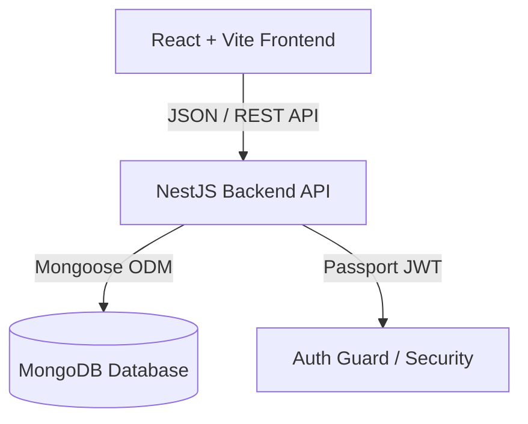
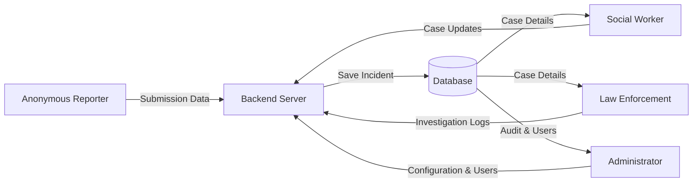
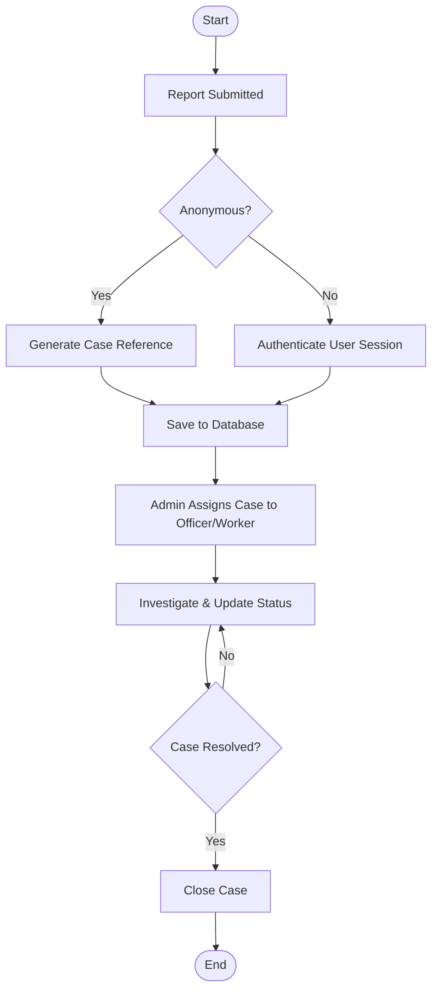
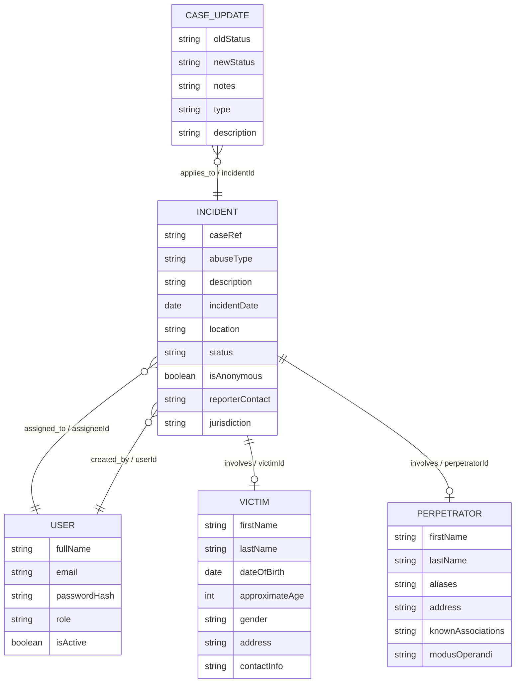

# Child Abuse Reporting System Diagrams

This document contains the visual Mermaid diagrams representing the system's architecture, use cases, data flow, system flowchart, and Entity Relationship Diagram (ERD).

---

## 1. System Architecture

Shows the high-level technical components of the monorepo application and how they communicate.



---

## 2. Use Case Diagram

Illustrates the roles of different system actors and the actions they can perform.

```mermaid
leftToRightDirection
actor Public as "Public / Anonymous"
actor Worker as "Social Worker"
actor Officer as "Law Enforcement"
actor Admin as "Administrator"

rectangle "Child Abuse Reporting System" {
    usecase UC1 as "Submit Anonymous Report"
    usecase UC2 as "Track Incident Status"
    usecase UC3 as "Manage Assigned Cases"
    usecase UC4 as "Update Case Investigation"
    usecase UC5 as "Manage Victims & Perpetrators"
    usecase UC6 as "Manage System Users"
    usecase UC7 as "View System Audit Logs"
end

Public --> UC1
Public --> UC2

Worker --> UC3
Worker --> UC5

Officer --> UC4
Officer --> UC5

Admin --> UC3
Admin --> UC5
Admin --> UC6
Admin --> UC7
```

---

## 3. Data Flow Diagram (Level 1)

Illustrates the movement of data between reporters, the database, workers, officers, and administrators.



---

## 4. System Flowchart

Illustrates the operational process flow of case submission, assignment, investigation, and resolution.



---

## 5. Entity Relationship Diagram (ERD)

Defines the collection schemas and references in the MongoDB database.


